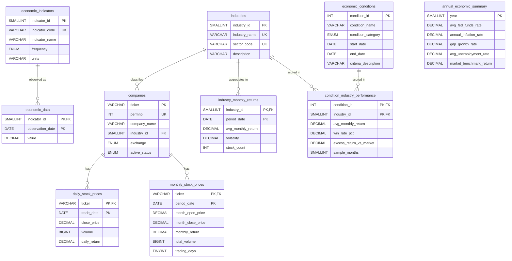

# Schema Contract — v1.0 (Phase 1 Lock)

**Project:** Analyzing Stock Market Performance Across Different Macroeconomic Environments
**Team:** Martin Villa, Youning Zheng, Ryan Marshall, Corey Rattray
**Database:** `stock_macro_db` on MySQL 8.0.16+ (tested on 8.0.46)

This document is the single source of truth for how data gets into the database. If your ETL output follows these rules, it will load and join cleanly with everyone else's. **If you need a rule changed, open a PR against `schema/` — do not change it locally.**

---

## 1. Files in `/schema`

| File | Purpose | When to run |
|---|---|---|
| `01_create_tables.sql` | Creates the database and all 10 tables. **Drops existing tables.** | Once on setup; again only after a schema change |
| `02_mock_seed.sql` | Synthetic sample rows for every table (truncates first) | Right after 01, for local testing |
| `03_validate_schema.sql` | Structure, FK, index and data-alignment checks (read-only) | After 01, and after every real data load |
| `SCHEMA_CONTRACT.md` | This document | Read before writing any ETL |

```bash
mysql -u root -p < schema/01_create_tables.sql
mysql -u root -p < schema/02_mock_seed.sql
mysql -u root -p < schema/03_validate_schema.sql
```

Expected result on the mock data: **59 PASS, 2 WARN, 0 FAIL**. The two WARNs are expected: some `condition_industry_performance` rows are placeholders, and `LEH` has no price rows. On real data, aim for 0 FAIL and 0 WARN.

---

## 2. Entity-Relationship Overview



The diagram renders on GitHub and in VS Code. For the EER slide in the presentation, use MySQL Workbench → *Database → Reverse Engineer* on `stock_macro_db`.

**Table roles**

| Layer | Tables | Loaded by |
|---|---|---|
| Lookup (fixed IDs) | `industries`, `economic_indicators` | Seed script (IDs must match everywhere) |
| Raw facts | `companies`, `daily_stock_prices`, `economic_data` | `etl_stocks`, `etl_macro` |
| First-level derived | `monthly_stock_prices`, `economic_conditions` | `etl_stocks`, `etl_macro` |
| Cross-domain derived | `industry_monthly_returns`, `condition_industry_performance`, `annual_economic_summary` | `analytics_queries` (SQL `INSERT … SELECT`) |

**Load order:** `industries` → `economic_indicators` → `companies` → `daily_stock_prices` → `monthly_stock_prices` → `economic_data` → `economic_conditions` → `industry_monthly_returns` → `condition_industry_performance` → `annual_economic_summary`.

---

## 3. Date Granularity & Alignment Rules

**The rule: every period is identified by a `DATE` on the first day of that period.** It is never a string like `'2024-01'`, never an integer like `202401`, and never the last day of the month. The DDL enforces this with `CHECK (DAY(col) = 1)` on every period column, so a misaligned row fails to insert.

### 3.1 CRSP daily → monthly

| Item | Rule |
|---|---|
| `trade_date` | The actual CRSP trading date (`DATE`, `YYYY-MM-DD`). Weekdays only (enforced by a CHECK). |
| Month key | `period_date = first day of trade_date's month`. SQL: `CAST(DATE_FORMAT(trade_date, '%Y-%m-01') AS DATE)`. pandas: `df.trade_date.dt.to_period('M').dt.to_timestamp()` |
| `month_open_price` | `close_price` on the **first** trading day of the month. We don't store daily opens, so this is not the exchange opening price. |
| `month_close_price` | `close_price` on the **last** trading day of the month |
| `monthly_return` | Compounded daily returns: `∏(1 + daily_return) − 1`. Do **not** use `close/open − 1`. Prices are unadjusted, so a split would show up as a fake −50% move. CRSP `RET` is already adjusted for splits and dividends. |
| `total_volume` | `SUM(volume)` over the month |
| `trading_days` | `COUNT(*)` of daily rows in the month (used for QA) |
| Partial months | Keep them (e.g. an IPO mid-month). `trading_days` shows that the month is partial. |

`03_validate_schema.sql` re-aggregates the daily rows and fails if any monthly row disagrees.

### 3.2 FRED → monthly

FRED already labels each observation with the **first day of its period**, so we store FRED dates unchanged:

| Series | FRED frequency | Stored `observation_date` | Means |
|---|---|---|---|
| `FEDFUNDS` | Monthly (average of daily rates) | `2024-01-01` | Jan 2024 |
| `CPIAUCSL` | Monthly, SA | `2024-01-01` | Jan 2024 |
| `UNRATE` | Monthly, SA | `2024-01-01` | Jan 2024 |
| `GDP` / `GDPC1` | Quarterly, SAAR | `2024-01-01` | Q1 2024 (Jan–Mar) |

* **Only store monthly, quarterly or annual data in `economic_data`.** If you pull a daily or weekly series (e.g. `DFF`), average it to monthly in `etl_macro` before loading.
* Quarterly dates must fall in Jan, Apr, Jul or Oct. Annual dates must be Jan 1. Validation checks both.
* **Store raw FRED levels only.** Do not store derived numbers such as YoY inflation or GDP growth as new indicators. Compute them in SQL (patterns below) so there is one source of truth.
* FRED writes missing values as `.`. Drop those rows; never load them as 0.

### 3.3 Joining monthly stocks to macro data (tested patterns)

```sql
-- Monthly series (FEDFUNDS, CPIAUCSL, UNRATE): join on equal dates
JOIN economic_data ff
  ON ff.indicator_id = (SELECT indicator_id FROM economic_indicators WHERE indicator_code = 'FEDFUNDS')
 AND ff.observation_date = m.period_date

-- Quarterly series (GDP, GDPC1): every month maps to its quarter's start month
JOIN economic_data g
  ON g.indicator_id = (SELECT indicator_id FROM economic_indicators WHERE indicator_code = 'GDPC1')
 AND g.observation_date = DATE_SUB(m.period_date, INTERVAL (MONTH(m.period_date) - 1) % 3 MONTH)

-- Year-over-year CPI inflation (%) for month cur
100 * (cur.value / prev.value - 1)
  -- where prev.observation_date = cur.observation_date - INTERVAL 12 MONTH
```

*Known limitation (put this in the write-up):* GDP for a quarter is published about a month after the quarter ends. We assign it to the quarter's own months, so this is a descriptive study, not a tradable signal.

### 3.4 Economic-condition episodes

* One row in `economic_conditions` = one **episode**: a contiguous run of months that meets a rule. The same `condition_name` can have several episodes, each with its own `condition_id`.
* `start_date` = first month in the regime. `end_date` = **first day of the last month** in the regime. Both are inclusive. `end_date IS NULL` means the episode is still running at the end of our data.
* A month belongs to an episode when `period_date BETWEEN start_date AND COALESCE(end_date, '9999-12-01')`.
* Episodes of the same `condition_name` must not overlap (validated). Episodes of *different* conditions can overlap; for example, a month can be both "High Inflation" and "High Interest Rate".
* Starting rules (proposed; etl_macro can tune them, but must record the exact rule in `criteria_description`):

| condition_name | category | Rule (≥ 3 consecutive months) |
|---|---|---|
| High Interest Rate | INTEREST_RATE | `FEDFUNDS ≥ 4.00` |
| Low Interest Rate | INTEREST_RATE | `FEDFUNDS ≤ 1.00` |
| High Inflation | INFLATION | CPI YoY `≥ 4.00%` |
| Low Inflation | INFLATION | CPI YoY `≤ 1.50%` |
| High Unemployment | LABOR | `UNRATE ≥ 6.50` |
| Economic Contraction | GROWTH | Real GDP (GDPC1) QoQ annualized growth `< 0` |
| Strong Growth | GROWTH | Real GDP QoQ annualized growth `≥ 3.00%` |
| Stagflation | COMPOSITE | CPI YoY `≥ 4.00%` **and** `UNRATE ≥ 5.50` in the same month |

---

## 4. Data Types & Units

### 4.1 Unit convention (the most important rule in this document)

| Column name pattern | Unit | Example | Type |
|---|---|---|---|
| `*_return`, `volatility` | **Decimal fraction** | `0.0123` = +1.23% | `DECIMAL(10,6)` |
| `*_rate`, `*_pct` | **Percent points** | `5.33` = 5.33% | `DECIMAL(8,4)`; `win_rate_pct` is `DECIMAL(6,2)` |
| FRED `value` | The units in `economic_indicators.units` (as FRED publishes them) | `5.33`, `309.685`, `28624.069` | `DECIMAL(18,6)` |

CRSP `RET` is already a fraction, so load it as is. FRED rates are already in percent, so load them as is. **Never multiply or divide by 100 during loading.** Convert only in final presentation queries.

### 4.2 Column types

| Kind | MySQL type | Notes |
|---|---|---|
| Prices | `DECIMAL(12,4)` | Up to 99,999,999.9999. Always positive (CRSP shows negative `PRC` for bid/ask midpoints, so take `ABS(PRC)`). |
| Returns | `DECIMAL(10,6)` | Must be `≥ −1`. CRSP gives 6 decimal places. |
| Volume | `BIGINT UNSIGNED` | Number of shares (not hundreds). CRSP missing codes become `0`. |
| Dates | `DATE` | ISO `YYYY-MM-DD` in CSVs. Never `DATETIME`, strings or integers. |
| Surrogate IDs | `SMALLINT UNSIGNED` / `INT UNSIGNED` | Lookup IDs are **fixed in the seed** (see 4.4). |
| Floats | — | **Never use `FLOAT`/`DOUBLE`** for stored values (rounding drift). Pandas floats are fine; MySQL rounds them into `DECIMAL` on insert. |

### 4.3 Ticker standardization

* Allowed format: uppercase ASCII letters and digits, 1–8 characters, plus an optional `.X` share-class suffix. Regex: `^[A-Z0-9]{1,8}([.][A-Z])?$`. Examples: `AAPL`, `XOM`, `BRK.B`. Not allowed: `aapl`, `BRK B`, `BRK-B`, `BRK/B`.
* Build it from CRSP as `UPPER(TRIM(TICKER))`, and add `'.' + SHRCLS` when CRSP has a share class.
* All ticker columns are `VARCHAR(10) CHARACTER SET ascii COLLATE ascii_bin` (case-sensitive). The CHECK constraint rejects anything else.
* **One ticker ↔ one PERMNO.** CRSP reuses tickers over time. Use the most recent ticker for each PERMNO in our date window. If two PERMNOs end up with the same ticker, stop and tell the schema owner; don't invent a suffix.
* `companies.permno` keeps a link back to CRSP. Fill it in for every real row.

### 4.4 Fixed lookup IDs (do not renumber)

`industries` — **Fama-French 12** classification, mapped from CRSP `SICCD` with Ken French's `Siccodes12` file:

| id | code | name | id | code | name |
|---|---|---|---|---|---|
| 1 | NODUR | Consumer NonDurables | 7 | TELCM | Telecom |
| 2 | DURBL | Consumer Durables | 8 | UTILS | Utilities |
| 3 | MANUF | Manufacturing | 9 | SHOPS | Shops |
| 4 | ENRGY | Energy | 10 | HLTH | Healthcare |
| 5 | CHEMS | Chemicals | 11 | MONEY | Finance |
| 6 | BUSEQ | Business Equipment (Tech) | 12 | OTHER | Other (**also used when SIC is missing or unmapped**) |

`economic_indicators`: `1 FEDFUNDS`, `2 CPIAUCSL`, `3 GDP`, `4 UNRATE`, `5 GDPC1`. New series get the next free ID through a PR to the seed.

**ETL must look up IDs by code** (`sector_code`, `indicator_code`). Never hard-code IDs that aren't in this table.

### 4.5 Other CRSP rules

* Keep common stock only: `SHRCD IN (10, 11)`.
* `exchange`: `EXCHCD` 1 = `NYSE`, 2 = `AMEX`, 3 = `NASDAQ`, anything else = `OTHER`.
* **Keep delisted firms** (`active_status = 'DELISTED'`). Dropping them causes survivorship bias. Optional: fold CRSP `DLRET` into the final month's return.
* Skip daily rows where `PRC` is missing or 0. If `RET` is a letter code (`B`, `C`, …), load `daily_return = NULL` (validation shows these as a WARN).

### 4.6 Derived-metric definitions

| Metric | Definition |
|---|---|
| Market return (month) | Equal-weighted `AVG(monthly_return)` over **all** stocks in `monthly_stock_prices` that month |
| `industry_monthly_returns.avg_monthly_return` | Equal-weighted `AVG(monthly_return)` of the industry's stocks |
| `industry_monthly_returns.volatility` | Cross-sectional `STDDEV_SAMP` of those returns; `NULL` if `stock_count < 2` |
| `condition_industry_performance.avg_monthly_return` | `AVG` of the industry's monthly averages over the episode's months |
| `win_rate_pct` | `100 ×` share of episode months where the industry return was `> 0` |
| `excess_return_vs_market` | Industry avg return − market avg return over the same months |
| `sample_months` | Number of episode months with data |
| `annual_inflation_rate` | % change in the annual-average CPIAUCSL vs the prior year |
| `gdp_growth_rate` | % change in the annual-average GDPC1 (real) vs the prior year |
| `market_benchmark_return` | `∏(1 + monthly market return) − 1` over the calendar year |

`03_validate_schema.sql` recomputes `industry_monthly_returns` and `condition_industry_performance` from source and fails on any mismatch.

---

## 5. Proposed Scope (confirm as a team)

* **Dates:** 2000-01 through 2024-12. This covers the dot-com bust, the GFC, ZIRP, COVID and the 2022–23 inflation and rate-hike cycle.
* **Universe:** about 25 of the largest common stocks per FF12 industry by market cap, including names that were later delisted. That is roughly 300 tickers × ~6,300 trading days ≈ **1.9M daily rows**, which is comfortable for MySQL on a laptop.
* **Bulk loading:** use `LOAD DATA LOCAL INFILE` from CSV (start the client with `--local-infile=1`). Avoid row-by-row inserts for daily data.

---

## 6. Team Workflow Rules

1. Only the schema owner edits `01_create_tables.sql` and `02_mock_seed.sql`. Changes go through a PR that bumps the version at the top of this file.
2. Each workstream works only in its own folder (`etl_stocks/`, `etl_macro/`, `analytics_queries/`). That way there are no merge conflicts.
3. ETL scripts write CSVs whose column names and order **exactly match** the target table, then load them with `LOAD DATA`.
4. Run `03_validate_schema.sql` after every load. Don't merge or share a dump with any FAIL.
5. Don't commit raw CRSP extracts to git (WRDS license). Add `*.csv` / `data/` to `.gitignore` and share data through the team drive.
