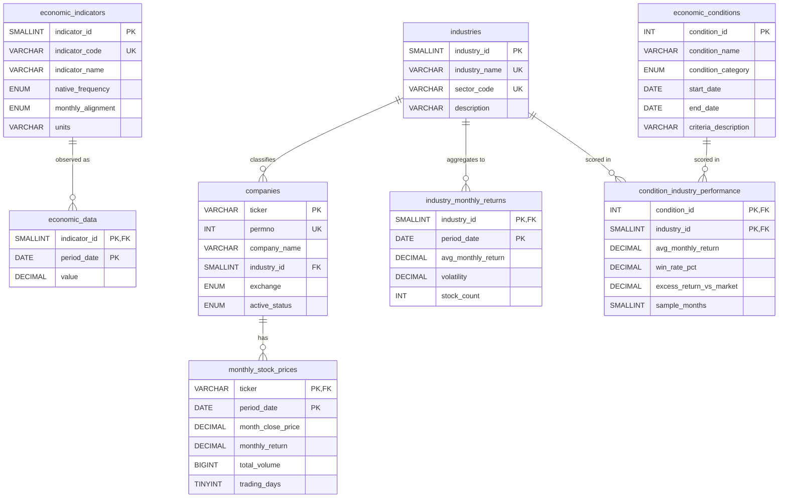

# Schema Contract — v2.0 (Monthly-Only, 8 Tables)

**Project:** Analyzing Stock Market Performance Across Different Macroeconomic Environments
**Team:** Martin Villa, Youning Zheng, Ryan Marshall, Corey Rattray
**Database:** `stock_macro_db` on MySQL 8.0.16+ (tested on 8.0.46)

This document is the single source of truth for how data gets into the database. If your ETL output follows these rules, it will load and join cleanly with everyone else's. **If you need a rule changed, open a PR against `schema/` — do not change it locally.**

### What changed from v1.0
* **Removed `daily_stock_prices`.** Stock data now comes straight from the CRSP **Monthly** Stock File, which already matches the monthly cadence of FRED.
* **Removed `annual_economic_summary`.** Yearly figures are computed in queries (`GROUP BY YEAR(period_date)`), so we don't store a redundant copy.
* **Removed mock data.** We go straight to real CRSP and FRED data. `02_reference_data.sql` holds only the real lookup definitions (industries and FRED series).
* **`economic_data` is now strictly monthly.** Quarterly GDP is repeated across its three months, so every indicator has exactly one row per month.
* Renamed `economic_data.observation_date` → `period_date`. Stock and macro tables now join on `period_date = period_date`.
* Dropped `month_open_price`, which the CRSP monthly file doesn't provide. `trading_days` is now optional (NULL allowed).

---

## 1. Files in `/schema`

| File | Purpose | When to run |
|---|---|---|
| `01_create_tables.sql` | Creates the database and all 8 tables. **Drops existing tables**, including the removed v1.0 tables. | Once on setup; again only after a schema change |
| `02_reference_data.sql` | Real lookup rows with **fixed IDs**: 12 Fama-French industries and 5 FRED series. Re-runnable (upsert) and never deletes data. | Right after 01, **before** any CRSP/FRED load |
| `03_validate_schema.sql` | Checks structure, keys, indexes, reference data and data alignment. Read-only, and safe on empty tables. | After 01/02, and after every data load |
| `SCHEMA_CONTRACT.md` | This document | Read before writing any ETL |

```bash
mysql -u root -p < schema/01_create_tables.sql
mysql -u root -p < schema/02_reference_data.sql
mysql -u root -p < schema/03_validate_schema.sql
```

Expected validation results:

| State | PASS | WARN | FAIL |
|---|---|---|---|
| After 01 only (empty) | 56 | 2 (reference data not loaded) | 0 |
| After 01 + 02 | 58 | 0 | 0 |
| After real data loads | 58 | 0 (investigate any) | **0 (required)** |

Section 8 of the report prints INFO rows: row counts per table, the stock universe size and the date ranges.

---

## 2. Entity-Relationship Overview



The diagram renders on GitHub and in VS Code. For the EER slide in the presentation, use MySQL Workbench → *Database → Reverse Engineer* on `stock_macro_db`.

There is deliberately **no foreign key between `economic_conditions` and `economic_data`**. A condition episode is a date range, not a single row. It links to months through `period_date BETWEEN start_date AND end_date` (§3.4).

**Table roles**

| Layer | Tables | Loaded by |
|---|---|---|
| Lookup (fixed IDs) | `industries`, `economic_indicators` | `02_reference_data.sql` |
| Raw facts | `companies`, `monthly_stock_prices`, `economic_data` | `etl_stocks`, `etl_macro` |
| Derived from macro | `economic_conditions` | `etl_macro` (regime classifier) |
| Cross-domain derived | `industry_monthly_returns`, `condition_industry_performance` | `analytics_queries` (SQL `INSERT … SELECT`) |

**Load order:** `01` → `02` → `companies` → `monthly_stock_prices` → `economic_data` → `economic_conditions` → `industry_monthly_returns` → `condition_industry_performance` → `03`.

---

## 3. Date Granularity & Alignment Rules

**The rule: every row in every table is monthly, identified by a `DATE` on the first day of the month (`YYYY-MM-01`).** It is never a string like `'2024-01'`, never an integer like `202401`, and never the last day of the month. The DDL enforces this with `CHECK (DAY(col) = 1)`, so a misaligned row fails to insert.

### 3.1 CRSP Monthly Stock File (MSF) → `monthly_stock_prices`

| Column | Source & rule |
|---|---|
| `period_date` | CRSP `DATE` is the last trading day of the month (e.g. `2024-01-31`). Map it to `2024-01-01`. pandas: `df.date.dt.to_period('M').dt.to_timestamp()`. SQL: `CAST(DATE_FORMAT(date, '%Y-%m-01') AS DATE)` |
| `month_close_price` | `ABS(PRC)`. CRSP shows a negative `PRC` when it's a bid/ask midpoint. Unadjusted. |
| `monthly_return` | CRSP `RET`: total return including dividends, already adjusted for splits. Stored as a fraction. **Don't compute it from prices**, because a split would look like a −50% crash. |
| `total_volume` | CRSP MSF `VOL` **× 100**. MSF reports volume in hundreds of shares, and we store shares. |
| `trading_days` | Number of NYSE trading days in the month. This is market-wide, so it's the same for every stock. Get it by counting days per month in the CRSP daily index file (DSI, one small row per trading day). Leave it NULL if you skip that. |

* Skip rows where `PRC` is missing or 0, or where `RET` is missing or a letter code (`B`, `C`, …). `monthly_return` is `NOT NULL`.
* Keep common stock only (`SHRCD IN (10, 11)`).
* A stock's first month in CRSP often has no `RET`. Dropping that row is expected and doesn't count as a gap.

### 3.2 FRED → `economic_data` (one row per indicator per month)

| Series | FRED frequency | `monthly_alignment` | How to store it |
|---|---|---|---|
| `FEDFUNDS` | Monthly (average of daily rates) | `DIRECT` | FRED `2024-01-01` → `period_date 2024-01-01` |
| `CPIAUCSL` | Monthly, SA | `DIRECT` | as above |
| `UNRATE` | Monthly, SA | `DIRECT` | as above |
| `GDP` | Quarterly, SAAR | `QUARTER_REPEAT` | FRED `2024-01-01` (Q1) → **three rows**: `2024-01-01`, `2024-02-01`, `2024-03-01`, all with the same value |
| `GDPC1` | Quarterly, SAAR | `QUARTER_REPEAT` | as above |
| *(any daily/weekly series added later)* | D / W | `MONTHLY_AVERAGE` | Average within each month and store on `YYYY-MM-01`. FRED's download page can do this (Frequency = Monthly, Aggregation = Average). |

* **Coverage rule:** every month that has stock data must have a value for **every** indicator, and an indicator's series can't have internal gaps. Validation check 7a/7b fails otherwise.
* **Store raw FRED levels only.** Do not store YoY inflation or GDP growth as new indicators. Compute them in SQL (§3.3) so there's one source of truth.
* FRED writes missing values as `.`. Drop those rows; never load them as 0.
* Pull a few months **before** the stock window starts (at least 12). YoY inflation for Jan 2000 needs CPI from Jan 1999. Validation only requires macro coverage for months that have stock data, so the extra history is fine.

### 3.3 Joining stocks to macro data (tested patterns)

Because every indicator has one row per month, every join is a plain equality join:

```sql
-- Any indicator, monthly or quarterly: same join
JOIN economic_data ff
  ON ff.indicator_id = (SELECT indicator_id FROM economic_indicators WHERE indicator_code = 'FEDFUNDS')
 AND ff.period_date  = m.period_date

-- Year-over-year CPI inflation (%) for month cur
100 * (cur.value / prev.value - 1)       -- prev.period_date = cur.period_date - INTERVAL 12 MONTH

-- Real GDP growth, quarter-over-quarter annualized (%), valid in every month
-- because quarterly values are repeated
100 * (POW(cur.value / prev.value, 4) - 1)   -- prev.period_date = cur.period_date - INTERVAL 3 MONTH

-- Yearly figures (replaces the old annual_economic_summary table)
SELECT YEAR(period_date) AS yr, AVG(value) AS avg_fed_funds
FROM economic_data WHERE indicator_id = 1 GROUP BY YEAR(period_date);
```

*Known limitation (put this in the write-up):* GDP for a quarter is published about a month after the quarter ends. We assign it to the quarter's own months, so this is a descriptive study, not a tradable signal.

### 3.4 Economic-condition episodes

* One row in `economic_conditions` = one **episode**: a contiguous run of months that meets a rule. The same `condition_name` can have several episodes, each with its own `condition_id`.
* `start_date` = first month in the regime. `end_date` = **first day of the last month** in the regime. Both are inclusive. `end_date IS NULL` means the episode is still running at the end of our data.
* A month belongs to an episode when `period_date BETWEEN start_date AND COALESCE(end_date, '9999-12-01')`.
* Episodes of the same `condition_name` must not overlap (validated). Episodes of *different* conditions can overlap; for example, a month can be both "High Inflation" and "High Interest Rate".
* Starting rules (proposed; etl_macro can tune them, but must record the exact rule in `criteria_description`):

| condition_name | category | Rule (≥ 3 consecutive months) |
|---|---|---|
| High Interest Rate | INTEREST_RATE | `FEDFUNDS ≥ 4.00` |
| Low Interest Rate | INTEREST_RATE | `FEDFUNDS ≤ 1.00` |
| High Inflation | INFLATION | CPI YoY `≥ 4.00%` |
| Low Inflation | INFLATION | CPI YoY `≤ 1.50%` |
| High Unemployment | LABOR | `UNRATE ≥ 6.50` |
| Economic Contraction | GROWTH | Real GDP (GDPC1) QoQ annualized growth `< 0` |
| Strong Growth | GROWTH | Real GDP QoQ annualized growth `≥ 3.00%` |
| Stagflation | COMPOSITE | CPI YoY `≥ 4.00%` **and** `UNRATE ≥ 5.50` in the same month |

---

## 4. Data Types & Units

### 4.1 Unit convention (the most important rule in this document)

| Column name pattern | Unit | Example | Type |
|---|---|---|---|
| `*_return`, `volatility` | **Decimal fraction** | `0.0123` = +1.23% | `DECIMAL(10,6)` |
| `*_pct` | **Percent points** | `55.00` = 55% | `DECIMAL(6,2)` |
| FRED `value` | The units in `economic_indicators.units` (as FRED publishes them) | `5.33`, `309.685`, `28624.069` | `DECIMAL(18,6)` |

CRSP `RET` is already a fraction, so load it as is. FRED rates are already in percent, so load them as is. **Never multiply or divide by 100 during loading.** The one exception is CRSP volume (× 100 to convert hundreds of shares to shares). Validation warns about returns above +300% and about "Percent" series whose values are all ≤ 1, because both usually mean a unit mistake.

### 4.2 Column types

| Kind | MySQL type | Notes |
|---|---|---|
| Prices | `DECIMAL(12,4)` | Always positive. |
| Returns | `DECIMAL(10,6)` | Must be `≥ −1`. CRSP gives 6 decimal places. |
| Volume | `BIGINT UNSIGNED` | Shares. |
| Dates | `DATE` | ISO `YYYY-MM-01` in CSVs. Never `DATETIME`, strings or integers. |
| Surrogate IDs | `SMALLINT UNSIGNED` / `INT UNSIGNED` | Lookup IDs are **fixed** by `02_reference_data.sql`. |
| Floats | — | **Never use `FLOAT`/`DOUBLE`** for stored values. Pandas floats are fine; MySQL rounds them into `DECIMAL` on insert. |

### 4.3 Ticker standardization

* Allowed format: uppercase ASCII letters and digits, 1–8 characters, plus an optional `.X` share-class suffix. Regex: `^[A-Z0-9]{1,8}([.][A-Z])?$`. Examples: `AAPL`, `XOM`, `BRK.B`. Not allowed: `aapl`, `BRK B`, `BRK-B`, `BRK/B`.
* Build it from CRSP as `UPPER(TRIM(TICKER))`, and add `'.' + SHRCLS` when CRSP has a share class.
* Ticker columns are `VARCHAR(10) CHARACTER SET ascii COLLATE ascii_bin` (case-sensitive). A CHECK constraint rejects anything else.
* **One ticker ↔ one PERMNO.** `permno` is `NOT NULL UNIQUE`. CRSP reuses tickers over time, so use the most recent ticker for each PERMNO in our window. If two PERMNOs end up with the same ticker, stop and tell the schema owner; don't invent a suffix.

### 4.4 Fixed lookup IDs (do not renumber)

`industries` — **Fama-French 12** classification, mapped from CRSP `SICCD` with Ken French's `Siccodes12` file:

| id | code | name | id | code | name |
|---|---|---|---|---|---|
| 1 | NODUR | Consumer NonDurables | 7 | TELCM | Telecom |
| 2 | DURBL | Consumer Durables | 8 | UTILS | Utilities |
| 3 | MANUF | Manufacturing | 9 | SHOPS | Shops |
| 4 | ENRGY | Energy | 10 | HLTH | Healthcare |
| 5 | CHEMS | Chemicals | 11 | MONEY | Finance |
| 6 | BUSEQ | Business Equipment (Tech) | 12 | OTHER | Other (**also used when SIC is missing or unmapped**) |

`economic_indicators`: `1 FEDFUNDS`, `2 CPIAUCSL`, `3 GDP`, `4 GDPC1`, `5 UNRATE`. New series get the next free ID through a PR to `02_reference_data.sql`.

**ETL must look up IDs by code** (`sector_code`, `indicator_code`). Never hard-code IDs that aren't in this table.

### 4.5 Other CRSP rules

* `exchange`: `EXCHCD` 1 = `NYSE`, 2 = `AMEX`, 3 = `NASDAQ`, anything else = `OTHER`.
* **Keep delisted firms** (`active_status = 'DELISTED'`). Dropping them causes survivorship bias. Optional: fold CRSP `DLRET` into the final month's return.

### 4.6 Derived-metric definitions

| Metric | Definition |
|---|---|
| Market return (month) | Equal-weighted `AVG(monthly_return)` over **all** stocks in `monthly_stock_prices` that month. Compute it in a view; don't store it. |
| `industry_monthly_returns.avg_monthly_return` | Equal-weighted `AVG(monthly_return)` of the industry's stocks |
| `industry_monthly_returns.volatility` | Cross-sectional `STDDEV_SAMP` of those returns; `NULL` if `stock_count < 2` |
| `condition_industry_performance.avg_monthly_return` | `AVG` of the industry's monthly averages over the episode's months |
| `win_rate_pct` | `100 ×` share of episode months where the industry return was `> 0` |
| `excess_return_vs_market` | Industry avg return − market avg return over the same months |
| `sample_months` | Number of episode months with data |

`03_validate_schema.sql` recomputes both derived tables from source. It fails on any wrong value, on an industry-month that should exist but doesn't, and on a stale row that has no source data.

---

## 5. Scope (confirm as a team)

* **Dates:** 2000-01 through 2024-12 (300 months). This covers the dot-com bust, the GFC, ZIRP, COVID and the 2022–23 inflation and rate-hike cycle. Pull FRED from 1999-01 so YoY measures exist from the first month.
* **Universe: ~500 US companies.** Recommended: **historical S&P 500 members** from the CRSP S&P 500 constituent file (`crsp.msp500list` on WRDS). Keep each stock's monthly rows only for the months it was in the index. That gives about 500 stocks per month, includes companies later removed or delisted (no survivorship bias), and lands at roughly **150,000 monthly rows**. If you use today's S&P 500 list instead, the write-up must say the results favor survivors.
* **Bulk loading:** use `LOAD DATA LOCAL INFILE` from CSV (start the client with `--local-infile=1`).

---

## 6. Team Workflow Rules

1. Only the schema owner edits `01_create_tables.sql` and `02_reference_data.sql`. Changes go through a PR that bumps the version at the top of this file.
2. Each workstream works only in its own folder (`etl_stocks/`, `etl_macro/`, `analytics_queries/`). That way there are no merge conflicts.
3. ETL scripts write CSVs whose column names and order **exactly match** the target table, then load them with `LOAD DATA`.
4. Run `03_validate_schema.sql` after every load. Don't merge or share a dump with any FAIL.
5. Don't commit raw CRSP extracts to git (WRDS license). `.gitignore` already excludes `*.csv` and `data/`. Share data through the team drive.
