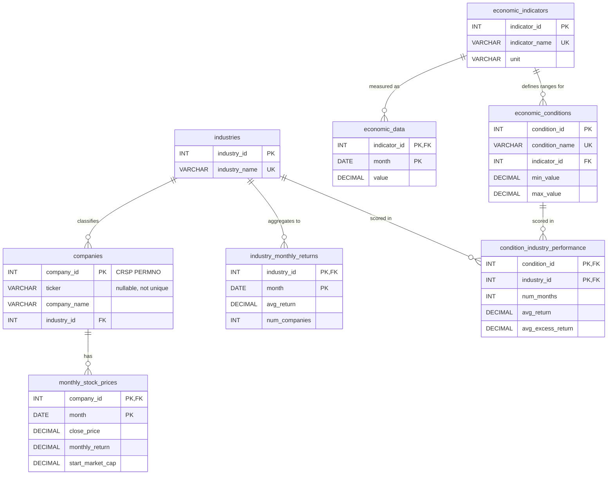

# Schema Contract — v3.0 (Matches the Real Data)

**Project:** Analyzing Stock Market Performance Across Different Macroeconomic Environments
**Team:** Martin Villa, Youning Zheng, Ryan Marshall, Corey Rattray
**Database:** `stock_analysis` on MySQL 8.0.16+ (tested on 8.0.46)
**Data:** `Dump20261126.sql` (team drive, **not** in git: it contains licensed CRSP data)

This document describes the database exactly as the real data defines it. **If you need a rule changed, open a PR against `schema/` — do not change it locally.**

### What changed from v2.0
v2.0 was a design written before any data existed. v3.0 adopts the structure of the real-data dump, which was already internally consistent: both derived tables recompute exactly from the raw rows. v3.0 keeps the dump's columns unchanged and adds the strict rules from v2.0 on top: CHECK constraints, first-of-month dates, secondary indexes and explicit FK actions.

| Topic | v2.0 (design) | v3.0 (real data) |
|---|---|---|
| Database | `stock_macro_db` | `stock_analysis` |
| Company key | `ticker` | `company_id` = CRSP PERMNO (tickers are reused, see §4.2) |
| Date column | `period_date` | `month` |
| Window | 2000–2024 | **2015-01 → 2025-12** (132 months) |
| Universe | ~500 companies | **All CRSP common stocks**: 8,833 companies, ~4,800 per month |
| Industries | Fama-French 12 | 11 sectors |
| Macro values | Raw FRED levels | Ready-made percentages (Fed funds, CPI YoY, unemployment, real GDP growth) |
| Conditions | Dated episodes | **Value ranges** on one indicator (Low / Moderate / High) |
| Industry return | Equal-weighted + volatility | **Market-cap weighted** |

---

## 1. Files in `/schema`

| File | Purpose | When to run |
|---|---|---|
| `01_create_tables.sql` | Creates `stock_analysis` and all 8 tables with constraints. **Drops existing tables.** | Once on setup; again only after a schema change |
| `02_load_data.sh` | Loads the data rows from the dump into those tables. Re-runnable: empties the tables first. | After 01, and whenever there is a new dump |
| `03_validate_schema.sql` | Checks structure, keys, indexes and orphans, and fully recomputes both derived tables. Read-only. | After every load |
| `SCHEMA_CONTRACT.md` | This document | Read before writing queries |

```bash
mysql -u root -p < schema/01_create_tables.sql
bash schema/02_load_data.sh ~/Downloads/Dump20261126.sql -u root -p
mysql -u root -p < schema/03_validate_schema.sql
```

> ⚠️ **Do not load the dump with `mysql < Dump20261126.sql` or Workbench "Import".** The dump has its own `CREATE TABLE` statements, which would replace our tables and silently remove all 14 CHECK constraints and 3 indexes. Validation catches this (4 FAILs in section 4). If you can't run bash (e.g. on Windows without Git Bash), re-export from Workbench with **"Dump Data Only"** and import that file after running `01_create_tables.sql`.

**Expected result on `Dump20261126.sql`:** 50 PASS, 4 WARN, **0 FAIL**, 10 INFO. Load time is about 4 seconds. The 4 WARNs are known characteristics of the data (§5). On an empty schema the result is 54 PASS, 0 WARN, 0 FAIL.

---

## 2. Entity-Relationship Overview



The diagram renders on GitHub and in VS Code. For the EER slide, use MySQL Workbench → *Database → Reverse Engineer* on `stock_analysis` **after** `01_create_tables.sql`, so the diagram shows our constraints.

| Layer | Tables |
|---|---|
| Lookup | `industries`, `economic_indicators`, `economic_conditions` |
| Raw facts | `companies`, `monthly_stock_prices`, `economic_data` |
| Derived | `industry_monthly_returns`, `condition_industry_performance` |

---

## 3. Dates & Joins

**Every table is monthly. Every `month` column is a `DATE` on the first day of the month (`YYYY-MM-01`).** This is enforced with `CHECK (DAY(month) = 1)`.

* CRSP month-end dates were mapped to the first of the month (`2024-01-31` → `2024-01-01`).
* Real GDP growth is quarterly. Its value is repeated in all three months of the quarter (validated in 6b).
* Stocks and macro data therefore join directly on `month`:

```sql
-- Stock returns alongside the Fed funds rate
SELECT c.ticker, m.month, m.monthly_return, ff.value AS fed_funds
FROM monthly_stock_prices m
JOIN companies c       ON c.company_id = m.company_id
JOIN economic_data ff  ON ff.month = m.month
                      AND ff.indicator_id = (SELECT indicator_id FROM economic_indicators
                                             WHERE indicator_name = 'Federal Funds Rate');

-- Months in a condition (min inclusive, max exclusive)
SELECT d.month
FROM economic_conditions ec
JOIN economic_data d ON d.indicator_id = ec.indicator_id
                    AND (ec.min_value IS NULL OR d.value >= ec.min_value)
                    AND (ec.max_value IS NULL OR d.value <  ec.max_value)
WHERE ec.condition_name = 'High Inflation';

-- Market return per month (cap-weighted, all stocks), the benchmark for excess returns
SELECT month, SUM(monthly_return * start_market_cap) / SUM(start_market_cap) AS market_return
FROM monthly_stock_prices
WHERE monthly_return IS NOT NULL AND start_market_cap IS NOT NULL
GROUP BY month;
```

*Known limitation (put this in the write-up):* GDP for a quarter is published about a month after the quarter ends. We assign it to the quarter's own months, so this is a descriptive study, not a tradable signal.

---

## 4. Tables, Units & Definitions

### 4.1 Units

| Column | Unit | Example |
|---|---|---|
| `monthly_return`, `avg_return`, `avg_excess_return` | **Decimal fraction** | `0.05` = +5% |
| `economic_data.value`, `min_value`, `max_value` | **Percent points** | `5.33` = 5.33% |
| `start_market_cap` | **USD thousands**, at the previous month-end | `1107984309.60` ≈ $1.1 trillion |
| `close_price` | USD, unadjusted | |

### 4.2 Companies

* `company_id` is the **CRSP PERMNO**: one permanent number per security.
* `ticker` is informational only. It is **not unique**: CRSP reassigns tickers over the years, so the 8,794 companies that have a ticker share only 8,533 distinct tickers (e.g. `CCC` belongs to 3 companies). It can also be NULL (39 companies). **Always join on `company_id`, never on `ticker`.**
* Tickers that are present match `^[A-Z0-9]{1,8}([.][A-Z])?$` (enforced).

### 4.3 Lookup values (fixed IDs)

`industries` (11):

| id | name | id | name |
|---|---|---|---|
| 1 | Technology | 7 | Consumer Staples |
| 2 | Telecommunications | 8 | Industrials |
| 3 | Health Care | 9 | Basic Materials |
| 4 | Financials | 10 | Energy |
| 5 | Real Estate | 11 | Utilities |
| 6 | Consumer Discretionary | | |

`economic_indicators` (4):

| id | name | unit / FRED source |
|---|---|---|
| 1 | Federal Funds Rate | Percent (FEDFUNDS) |
| 2 | Inflation Rate | Percent, CPI year over year (CPIAUCSL) |
| 3 | Unemployment Rate | Percent (UNRATE) |
| 4 | Real GDP Growth | Percent, annualized, quarterly value (A191RL1Q225SBEA) |

`economic_conditions` (12): three ranges per indicator. Min is inclusive, max is exclusive, and NULL means no bound. Validation 6c checks that every macro value falls in **exactly one** range of its indicator.

| Indicator | Low | Moderate | High |
|---|---|---|---|
| Fed funds | < 1 (Low Interest Rates) | 1 – 3 | ≥ 3 (High Interest Rates) |
| Inflation | < 2 | 2 – 4 | ≥ 4 |
| Unemployment | < 4 | 4 – 6 | ≥ 6 |
| Real GDP growth | < 0 (GDP Contraction) | 0 – 3 | ≥ 3 (Strong GDP Growth) |

### 4.4 Derived tables (validation recomputes both)

| Table.column | Definition |
|---|---|
| `industry_monthly_returns.avg_return` | `SUM(monthly_return × start_market_cap) / SUM(start_market_cap)` over the industry's stocks that month, using only rows where both values are present |
| `industry_monthly_returns.num_companies` | Number of stocks used in that weighted average |
| `condition_industry_performance.num_months` | Number of months where the condition held |
| `condition_industry_performance.avg_return` | `AVG(industry avg_return)` over those months |
| `condition_industry_performance.avg_excess_return` | `AVG(industry return − market return)` over those months, where the market return is cap-weighted over all stocks |

If you add a derived metric (e.g. volatility or a win rate), compute it in a **view** in `analytics_queries/`. Adding a column to a table would break reloading the dump, whose INSERTs have no column lists.

---

## 5. Known Data Characteristics (the 4 WARNs)

| WARN | Count | What it means / what to do |
|---|---|---|
| Missing macro months | Oct 2025 Inflation + Unemployment | BLS never published October 2025 CPI/UNRATE because of the government shutdown. That month is simply absent from those indicators' conditions. Mention it in the write-up. |
| Empty stock rows | 4,437 rows with no price, return or cap | They are excluded from every weighted calculation. Filter with `WHERE monthly_return IS NOT NULL` in queries. |
| Extreme returns > +300% | 283 rows (max +3,900%) | Almost all micro-caps. Cap weighting makes their effect on industry returns negligible. Be careful with **equal-weighted** or per-stock queries (consider `WHERE start_market_cap > …`). |
| NULL tickers | 39 companies | Identify them by `company_id` / `company_name`. |

**Scope consequences for the analysis:** 2015–2025 covers ZIRP, COVID and the 2022–23 inflation/rate-hike cycle, but **not** the 2008 GFC or the dot-com bust. Some conditions have few months (GDP Contraction: 9, High Unemployment: 13), so say that those averages are noisy.

---

## 6. Team Workflow Rules

1. Only the schema owner edits `01_create_tables.sql`. Changes go through a PR that bumps the version at the top of this file.
2. Columns must stay identical to the dump, in name, type and order. Anything new goes in views.
3. A new data export must keep the same 8 tables and columns. Then re-run `02_load_data.sh` and `03_validate_schema.sql`, and don't share it with any FAIL.
4. **Never commit dumps or CSVs** (licensed CRSP data). `.gitignore` excludes them. Share them through the team drive.
